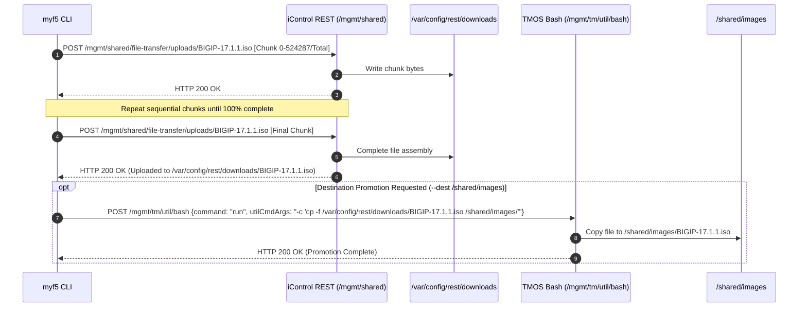
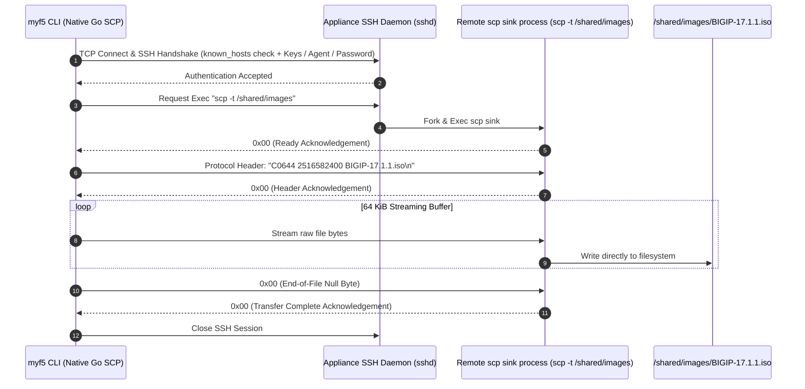

# Appliance Transfer Guide: BIG-IP & BIG-IQ Dual Push, Pull, and Automatic Failover Engine

The `myf5` appliance transfer engine enables direct, wire-speed bidirectional streaming of software images (`.iso`), engineering hotfixes, diagnostic QKViews (`.qkview`), and GeoDB packages between local systems and **F5 BIG-IP TMOS** (`myf5 bigip`) or **BIG-IQ Centralized Management** (`myf5 bigiq`) appliances.

By embedding both **iControl REST chunked transfer** and **verified native Go SCP over SSH** with an **automatic seamless failover engine**, `myf5` guarantees file transfers succeed even when one transport protocol is blocked, misconfigured, or restricted by firewall policies.

---

## Architectural Overview & Automatic Failover Engine

`myf5` provides first-class parity across `myf5 bigip <ready|info|serial|qkview|push|pull|download>` (plus `geoip`) and `myf5 bigiq <ready|info|serial|qkview|push|pull|download>`, as well as unified top-level commands (`myf5 ready`, `myf5 info`, `myf5 serial`, `myf5 qkview`, `myf5 push`, `myf5 pull`, `myf5 geoip`) accepting `--target auto|bigip|bigiq` (`"BIG-IQ"`, `"big-iq"`, `"bigiq"`, `"BIG-IP"`, `"big-ip"`, `"bigip"`, or `"auto"`).

1. **Automatic Failover Mode** (Default: `--method auto`)
   - **Upload (`push`)**: Streams `512 KiB` (`DefaultUploadChunkSize`) `Content-Range` chunks to `/mgmt/shared/file-transfer/uploads/<filename>` (or `/mgmt/cm/autodeploy/software-image-uploads/<filename>` for `.iso` images on BIG-IQ), promotes via `/mgmt/tm/util/bash`, and automatically fails over (or routes directly when `--target bigiq` targets non-ISO paths like `/var/tmp`) to verified `64 KiB` SCP when `webd` blocks `/mgmt/tm/util/bash` (`403 Forbidden`) or REST fails. Conversely, if an SSH key is explicitly provided (`-i`), SCP is attempted first with automatic REST fallback.
   - **Download (`pull` / `download`)**: Validates that the remote path is an `.iso` or `.qkview` inside `/shared/images`, `/var/config/rest/downloads`, `/var/tmp`, or `/shared/tmp` (`ValidateApplianceDownloadPath`). Downloads via `1 MiB` HTTP `Range` chunks (or single-response `200 OK` on BIG-IQ `/mgmt/shared/file-transfer/downloads/`), and automatically falls back to verified `64 KiB` SCP if REST returns 404 or is unavailable.
   - **Diagnostic QKView Generation & Downloads (`qkview`)**: On BIG-IP, calls `/mgmt/tm/util/qkview` (`-s0 -f /var/tmp/qkviews/<filename>`) or `/mgmt/cm/autodeploy/qkview` and downloads via REST with SCP fallback. On BIG-IQ, when REST `/mgmt/tm/util/qkview` or `/mgmt/tm/util/bash` is restricted, automatically routes directly to SSH/SCP (`/var/tmp` QKView generation and SCP retrieval).

2. **iControl REST Chunked Transfer** (`--method icontrol`)
   - Operates over HTTPS (port 443 or custom management port).
   - **BIG-IP & BIG-IQ Authentication**: BIG-IP uses HTTP Basic Auth or token auth; BIG-IQ uses token authentication via `POST /mgmt/shared/authn/login` with `{"username":"...","password":"..."}` (omitting `loginProviderName` per BIG-IQ REST API schema, with automatic fallback if required), refreshes tokens within 5 minutes of expiry via `POST /mgmt/shared/authn/exchange`, and stops immediately after 1 failed login attempt (`loginFailedErr`) to prevent appliance account lockout.
   - **Upload**: Breaks payloads into `512 KiB` (`524,288` bytes, `DefaultUploadChunkSize`) chunks transferred sequentially to `/mgmt/shared/file-transfer/uploads/<filename>` (staging in `/var/config/rest/downloads/<filename>` and promoting via `/mgmt/tm/util/bash`) or `/mgmt/cm/autodeploy/software-image-uploads/<filename>` for `.iso` images on BIG-IQ.
   - **Download**: Streams `.iso` and `.qkview` files in `1 MiB` HTTP `Range` chunks from `/mgmt/cm/autodeploy/software-image-downloads/`, `/mgmt/cm/autodeploy/qkview-downloads/`, or `/mgmt/shared/file-transfer/downloads/` (supporting single-response `200 OK` on BIG-IQ).
   - Ideal when SSH access is restricted by firewall policies, or when working through HTTPS reverse proxies and cloud access environments (e.g., F5 Unified Demonstration Framework / UDF).

3. **Native Go SCP over SSH** (`--method scp`)
   - Operates over SSH (port 22 or custom port).
   - Implements both remote SCP sink (receive/upload) and SCP source (transmit/download) protocols directly in pure Go (`golang.org/x/crypto/ssh`), requiring zero external OpenSSH binaries.
   - Verifies OpenSSH `known_hosts` host keys prior to sending credentials (`--known-hosts`, `--push-known-hosts`, `BIGIP_KNOWN_HOSTS`, `BIGIQ_KNOWN_HOSTS`, `MYF5_SSH_KNOWN_HOSTS`, `MYF5_STRICT_HOST_KEY_CHECKING=1`).
   - Streams payloads in `64 KiB` buffers (`65,536` bytes) in a single network pass.
   - Supports SSH key authentication (`-i`, encrypted keys via `SSH_AUTH_SOCK` `ssh-agent`) and password / keyboard-interactive (PAM / TACACS+ / RADIUS) authentication.

### Architecture Comparison Matrix

| Feature / Property | Automatic Failover (`auto`) | iControl REST (`icontrol`) | Native SCP over SSH (`scp`) |
| :--- | :--- | :--- | :--- |
| **Default Selection** | **Yes (Default)** | Explicit `--method icontrol` | Explicit `--method scp` |
| **Transport Protocol** | HTTPS or SSHv2 (Adaptive) | HTTPS (TLS 1.2 / 1.3) | SSHv2 |
| **Default Ports** | TCP 443 (REST) / TCP 22 (SSH) | TCP 443 | TCP 22 |
| **External Dependencies** | Zero | Zero (Pure Go `net/http`) | Zero (Pure Go `golang.org/x/crypto/ssh`) |
| **Network Path Compatibility** | All environments (Firewall resilient) | Web proxies, Cloud proxies, F5 UDF | Direct L3 / SSH bastions |
| **Shell Access Requirement** | Any role / shell (Adaptive fallback) | User with API access (independent of login shell) | User with Advanced Shell (`bash`) access or targeting `/var/tmp` |
| **Chunk / Buffer Size** | `512 KiB` upload / `1 MiB` download REST; `64 KiB` SCP | `512 KiB` upload (`Content-Range`) / `1 MiB` download (`Range`) | `64 KiB` streaming buffer |
| **Upload Destination** | Direct write or `/shared/images` | `/var/config/rest/downloads` (promoted) or BIG-IQ `software-image-uploads` | Direct destination write via `scp -t` |
| **Download Source** | Validated `.iso` / `.qkview` paths | Autodeploy / `file-transfer/downloads` | Validated `.iso` / `.qkview` paths via `scp -f` |
| **Authentication Methods** | Password, Token, mTLS, SSH Key, SSH Agent | Basic Auth / BIG-IQ Token (`/mgmt/shared/authn/login`), mTLS | SSH Key, SSH Agent (`SSH_AUTH_SOCK`), Password, PAM |
| **Appliance Compatibility** | BIG-IP TMOS (v13+), BIG-IQ (v7+) | BIG-IP TMOS (v13+), BIG-IQ (v7+) | BIG-IP TMOS (v13+) or BIG-IQ (v7+) |

---

## Transfer Flow Diagrams

### 1. iControl REST Chunked Upload & Promotion Flow



### 2. Native Go SCP over SSH Streaming Flow



---

## Authentication, `known_hosts` Verification, TLS & Zero-Secret Security

### Two-Tier Zero-Secret CLI Policy
Plaintext secrets are **never** accepted via command-line flags:
- **Tier 1 (`pkg/auth.CheckNoCLISecrets` on `os.Args[1:]`, Exit Code `2` before command dispatch)**: Blocks all 22 global secret flags (`--password`, `-password`, `--pw`, `-pw`, `--client-secret`, `-client-secret`, `--clientsecret`, `-clientsecret`, `--secret`, `-secret`, `--token`, `-token`, `--access-token`, `-access-token`, `--api-key`, `-api-key`, `--apikey`, `-apikey`, `--auth-token`, `-auth-token`, `--key`, `-key`).
- **Tier 2 (`cmd/myf5.rejectSecretFlag`, Exit Code `1` in appliance subcommand flag parsers)**: Blocks `--pass`, `-P`, and `--ssh-passphrase`.
- **Encrypted SSH Keys**: Private keys passed via `-i` / `--identity` (or `--push-key`) never prompt for a passphrase on the command line; encrypted SSH private keys are supported via `SSH_AUTH_SOCK` (`ssh-agent`).

### Pre-Authentication SSH `known_hosts` Verification
- **CLI Flags**: `--known-hosts <path>` (on `info`, `serial`, `qkview`, `push`, `pull`, `geoip`, and `bigip`/`bigiq` subcommands) and `--push-known-hosts <path>` (on `downloads get --push`).
- **Environment Variables**: `BIGIP_KNOWN_HOSTS`, `BIGIQ_KNOWN_HOSTS`, `MYF5_SSH_KNOWN_HOSTS`.
- **Strict Mode (`MYF5_STRICT_HOST_KEY_CHECKING=1` / `true` / `yes`)**: Enforces strict OpenSSH `known_hosts` verification before sending credentials—rejecting unknown, mismatched, and `@revoked` host keys.
- **Default Mode**: Checks `~/.ssh/known_hosts` if present and rejects any key mismatch or `@revoked` marker before credentials are sent, while allowing unknown ephemeral lab hosts if no entry matches.

### Appliance TLS & Custom Root CA Bundles
- Appliance iControl REST clients default to `SkipTLSVerify: true` for self-signed management certificates unless `MYF5_STRICT_APPLIANCE_TLS=1` (`true`/`yes`) is set, or mTLS (`--cert` / `--cert-key`, `BIGIP_CERT` / `BIGIP_KEY`, `BIGIQ_CERT` / `BIGIQ_KEY`) is used.
- `MYF5_CA_BUNDLE` and `SSL_CERT_FILE` load a custom PEM root CA bundle (e.g., corporate TLS inspection CA or private lab CA) into `pkg/client.SecureTLSConfig` across macOS, Linux, and Windows.

### Credential Resolution Hierarchy

`myf5` resolves appliance credentials through the following hierarchy:

```
1. Environment Variables:
   - BIG-IP: BIGIP_PASSWORD / BIGIP_USER (optional host lock: BIGIP_HOST)
   - BIG-IQ: BIGIQ_PASSWORD / BIGIQ_USER (falls back to BIGIP_*; optional host lock: BIGIQ_HOST)
     │ (If not set)
     ▼
2. SSH Key / Agent (SCP method):
   - Explicit flag: -i, --identity <path> (or --push-key <path>, BIGIP_SSH_KEY, BIGIQ_SSH_KEY, SSH_KEY_PATH)
   - SSH Agent: $SSH_AUTH_SOCK (supports encrypted private keys)
   - Default Identity Files: ~/.ssh/id_ed25519, ~/.ssh/id_rsa, ~/.ssh/id_ecdsa
     │ (If not available)
     ▼
3. Interactive Masked Terminal Prompt:
   - Terminal echo suppressed via term.ReadPassword
   - Enter password securely in interactive TTY sessions
```

### Environment Setup for Automated Pipelines (CI/CD)

For automated scripts and continuous delivery runners, export the appropriate environment variables:

```bash
# For BIG-IP appliances
export BIGIP_USER="admin"
export BIGIP_PASSWORD="YourSecureAppliancePassword"
export BIGIP_KNOWN_HOSTS="$HOME/.ssh/known_hosts"

# For BIG-IQ Centralized Management
export BIGIQ_USER="admin"
export BIGIQ_PASSWORD="YourSecureAppliancePassword"
export BIGIQ_KNOWN_HOSTS="$HOME/.ssh/known_hosts"
```

---

## Step-by-Step Practical Examples

### 1. Pushing a Base TMOS ISO Image for Installation

Software ISO images must reside in `/shared/images` on the BIG-IP appliance to be recognized by the TMOS software installation engine (`tmsh`).

#### Option A: Push via iControl REST with Automatic Promotion
```bash
myf5 bigip push 192.0.2.10 /var/tmp/BIGIP-17.1.1-0.0.6.iso \
    --method icontrol \
    --dest /shared/images
```

#### Option B: Push via Native Go SCP (Defaults to `/shared/images` automatically for ISOs)
```bash
myf5 bigip push 192.0.2.10 /var/tmp/BIGIP-17.1.1-0.0.6.iso \
    --method scp \
    --known-hosts ~/.ssh/known_hosts
```

#### Verifying the Staged Software Image
Once the file transfer completes, you can verify that TMOS detected the staged ISO in `/shared/images`:
```bash
# Verify the image is present and recognized in /shared/images
tmsh list sys software image BIGIP-17.1.1-0.0.6.iso
```
> **Scope Note:** `myf5` handles software downloads and staging/transfer to the appliance. Installing images onto boot volumes, activating boot locations, or triggering upgrade reboots is managed outside `myf5` via orchestration tooling (e.g., Ansible, Terraform) or standard TMOS administrative maintenance workflows.

---

### 2. Pushing an Engineering Hotfix

Hotfix ISO files are uploaded directly to `/shared/images` alongside base images.

```bash
# Push an engineering hotfix via native SCP using a specific SSH key and known_hosts
myf5 bigip push 192.0.2.10 /var/tmp/Hotfix-BIGIP-17.1.1.1.0.0.2-ENG.iso \
    --method scp \
    --identity ~/.ssh/f5_deploy_ed25519 \
    --known-hosts ~/.ssh/known_hosts
```

#### Verifying the Staged Hotfix
```bash
# Verify the hotfix image is recognized by TMOS
tmsh list sys software hotfix Hotfix-BIGIP-17.1.1.1.0.0.2-ENG.iso
```

---

### 3. Pushing an Updated GeoDB Archive & Applying Geolocation Updates (BIG-IP Only)

BIG-IP Application Security Manager (ASM / Advanced WAF), Advanced Firewall Manager (AFM), Access Policy Manager (APM), and DNS/GTM utilize IP geolocation databases supplied by **Digital Envoy** (NetAcuity Edge and Pulse variants, AskF5 K11176 / K78974041).

Active databases reside on the BIG-IP appliance filesystem under `/shared/GeoIP/` (and `/shared/GeoIP/v2/`). **Note:** `myf5 geoip` (and `--apply-geoip`) is **BIG-IP only** and is rejected on BIG-IQ because BIG-IQ Centralized Management does not host TMM GeoIP tables.

#### Automated One-Step Push and Activation (Recommended)
`myf5` stages the `.zip` archive to `/shared/tmp` (or `/var/tmp`), unpacks the internal `.rpm` files into `/shared/GeoIP` via `rpm2cpio | cpio -idmv` (and `geoip_update_data -f`), and executes `tmsh load sys geoip` across TMOS (per K11176):

```bash
# Push and automatically apply GeoIP updates in a single command:
myf5 bigip push 192.0.2.10 /var/tmp/ip-geolocation-default.zip --apply-geoip --json

# Or use the dedicated GeoIP command:
myf5 bigip geoip 192.0.2.10 /var/tmp/ip-geolocation-default.zip --json
# Top-level alias:
myf5 geoip 192.0.2.10 /var/tmp/ip-geolocation-default.zip --json
```

#### Manual Staging and TMOS Execution (Alternative)
If preferred, you can stage the archive manually in `/var/tmp` or `/shared/tmp`:

```bash
# Push GeoDB update archive to appliance staging directory via iControl REST
myf5 bigip push 192.0.2.10 /var/tmp/ip-geolocation-default.zip \
    --method icontrol \
    --dest /var/tmp
```

#### TMOS GeoDB Extraction, Installation & Verification
On TMOS, extract the container `.zip` archive and install each component `.rpm` package using the native `geoip_update_data` utility:

```bash
# 1. SSH into TMOS bash (requires Advanced Shell access or root)
ssh admin@192.0.2.10

# 2. Extract the update archive to a temporary staging folder
mkdir -p /shared/tmp/geoip_update
unzip -q /var/tmp/ip-geolocation-default.zip -d /shared/tmp/geoip_update

# 3. Apply the individual geolocation database RPM packages
geoip_update_data -f /shared/tmp/geoip_update/geoip-data-v2-Region2-*.i686.rpm
geoip_update_data -f /shared/tmp/geoip_update/geoip-data-v2-ISP-*.i686.rpm
geoip_update_data -f /shared/tmp/geoip_update/geoip-data-v2-Org-*.i686.rpm

# 4. Verify installed RPM versions
rpm -qa --dbpath /shared/lib/rpm/ | grep geoip

# 5. Verify database lookup resolution and build date
geoip_lookup 192.0.2.1

# 6. Reload active geolocation databases into TMOS microkernel (if needed)
tmsh load sys geoip

# 7. Clean up temporary extraction directory
rm -rf /shared/tmp/geoip_update /var/tmp/ip-geolocation-default.zip
```

> [!NOTE]
> `tmsh show sys geoip` or `tmsh show sys geoip info` is not a valid TMOS command. Verification is performed using `geoip_lookup <ip_address>` in Bash or inspecting installed RPMs via `rpm -qa --dbpath /shared/lib/rpm/ | grep geoip`. Database reload into memory is performed via `tmsh load sys geoip` or `geoip_reload_data`.
>
> If deploying the **Digital Envoy Pulse** database, ensure the BIG-IP system has at least 900 MB of available memory provisioned. Pulse does not support the city-level granularity tier (AskF5 K78974041).

---

### 4. BIG-IQ Centralized Management Operations & Repository Transfers

BIG-IQ Centralized Management stores managed software images and hotfixes in its centralized software repository (`/shared/images`), allowing administrators to orchestrate upgrades across fleets of BIG-IP devices from a single console.

- **Token Authentication & Lockout Protection**: Authenticates via `POST /mgmt/shared/authn/login` with `{"username":"...","password":"..."}` (omitting `loginProviderName` per BIG-IQ REST API schema, with automatic fallback if required), refreshes tokens within 5 minutes of expiry via `POST /mgmt/shared/authn/exchange`, and stops immediately after 1 failed login attempt (`loginFailedErr`) to prevent appliance account lockout.
- **Readiness Probes**: `myf5 bigiq ready <host>` (or `myf5 ready <host>`) exits `0` when `READY` and `1` when `NOT READY` or on error; on BIG-IQ, when `/mgmt/tm/sys/ready` returns `403`/`404`, it probes `/mgmt/shared/echo`, `/mgmt/cm/system/machineid-resolver`, and `/mgmt/shared/failover-state`.
- **System Info & Serial (`info` / `serial`)**: Supports both live BIG-IQ hosts and offline `.qkview` archives (`pkg/bigip.InspectQKView`). On live BIG-IQ hosts, `GetSystemInfo` queries `/mgmt/shared/identified-devices/config/device-info` and `/mgmt/shared/resolver/device-groups/cm-shared-all-big-iqs/devices`, keeping hardware `ChassisSerialNumber` (`serialNumber`) distinct from UUID `machineId`.
- **Upload Routing (`push`)**: Streams `512 KiB` `Content-Range` chunks to `/mgmt/cm/autodeploy/software-image-uploads/<filename>` for `.iso` images on BIG-IQ (or `/mgmt/shared/file-transfer/uploads/<filename>`), and automatically fails over (or routes directly when `--target bigiq` targets non-ISO paths like `/var/tmp`) to verified `64 KiB` SCP when `webd` blocks `/mgmt/tm/util/bash` (`403 Forbidden`).

#### Check BIG-IQ Management Plane Readiness, Info & Serial
```bash
myf5 bigiq ready 192.0.2.50 --user admin
myf5 bigiq info 192.0.2.50 --user admin --json
myf5 bigiq serial 192.0.2.50 --user admin --json
```
*Output (`ready`):*
```
BIG-IQ appliance at 192.0.2.50 is READY (HTTP 200).
```

#### Push Software Image to BIG-IQ
```bash
# Push directly via BIG-IQ specific command
myf5 bigiq push 192.0.2.50 /var/tmp/BIGIP-17.1.1-0.0.6.iso \
    --method scp \
    --dest /shared/images \
    --known-hosts ~/.ssh/known_hosts

# Or use the unified push command
myf5 push 192.0.2.50 /var/tmp/BIGIP-17.1.1-0.0.6.iso \
    --target bigiq \
    --method icontrol \
    --dest /shared/images
```

---

### 5. Downloading Files from Appliances (`pull` / `download` with Automatic Failover)

`myf5` supports bidirectional file transfer for `.iso` and `.qkview` artifacts using `myf5 bigip download`, `myf5 bigip pull`, `myf5 bigiq download`, `myf5 bigiq pull`, or the top-level `myf5 pull`:

- **Strict Path Validation (`ValidateApplianceDownloadPath`)**: Validates that `<remote-path>` is an `.iso` or `.qkview` inside `/shared/images`, `/var/config/rest/downloads`, `/var/tmp`, or `/shared/tmp`.
- **Chunked & Single-Response REST Streaming**: Downloads via `1 MiB` HTTP `Range` chunks (or single-response `200 OK` on BIG-IQ `/mgmt/shared/file-transfer/downloads/`).
- **Verified SCP Fallback**: Automatically falls back to verified `64 KiB` SCP if REST returns 404 or is unavailable.

```bash
# Download a software image from /shared/images/ (attempts 1 MiB REST Range chunks, auto-fails over to SCP)
myf5 bigip download 10.1.1.4 /shared/images/BIGIP-17.1.1-0.0.6.iso -o ./BIGIP-17.1.1.iso

# Download a diagnostic QKView via native SCP with known_hosts verification
myf5 bigip download 10.1.1.4 /var/tmp/qkviews/support.qkview -o ./support.qkview --method scp --known-hosts ~/.ssh/known_hosts

# Unified pull command with specific SSH identity key
myf5 pull 10.1.1.4 /var/tmp/qkviews/support.qkview -o ./support.qkview -i ~/.ssh/id_ed25519 --known-hosts ~/.ssh/known_hosts

# Download from BIG-IQ central repository
myf5 bigiq download 192.0.2.50 /shared/images/BIGIP-17.1.1-0.0.6.iso -o ./BIGIP-17.1.1.iso
myf5 bigiq pull 192.0.2.50 /shared/images/BIGIP-17.1.1-0.0.6.iso -o ./BIGIP-17.1.1.iso
```

---

### 6. Resilient Diagnostic QKView Generation and Download (`bigip qkview` & `bigiq qkview`)

Generating a complete QKView diagnostic archive is critical for troubleshooting with F5 Technical Support. `myf5` runs a complete non-truncating (`-s0`) QKView generation on BIG-IP or BIG-IQ and retrieves it:

```bash
# Generate and download QKView from BIG-IP
myf5 bigip qkview 10.1.1.4 --user admin --known-hosts ~/.ssh/known_hosts

# Generate and download QKView from BIG-IQ
myf5 bigiq qkview 192.0.2.50 --user admin --known-hosts ~/.ssh/known_hosts

# Or via top-level shortcut
myf5 qkview 10.1.1.4 --user admin
```

1. **Remote Generation**: On BIG-IP, calls `/mgmt/tm/util/qkview` with arguments `-s0 -f /var/tmp/qkviews/<filename>` (or initiates an asynchronous task via `/mgmt/cm/autodeploy/qkview`) with live spinner reporting. On BIG-IQ, when REST `/mgmt/tm/util/qkview` or `/mgmt/tm/util/bash` is restricted, routes directly to SSH/SCP (`/var/tmp` QKView generation and SCP retrieval).
2. **Resilient Download**: Attempts `1 MiB` chunked REST download from `/mgmt/cm/autodeploy/qkview-downloads/<filename>`, falling back automatically to verified `64 KiB` SCP.
3. **Remote Cleanup**: Removes the temporary QKView file on the appliance after verified download unless `--keep-remote` is specified.

---

## End-to-End "Download & Push in One Step"

The `myf5 downloads get` command features native post-download push flags. When `--push <host>` is supplied, `myf5`:
1. Streams the software image from the authoritative MyF5 AWS CloudFront (`*.cloudfront.net`) signed CDN mirror to local disk with constant memory footprint (< 10 MB RAM).
2. Computes the SHA-256 digest on the fly via `io.TeeReader`.
3. Verifies the downloaded file's SHA-256 hash against the official catalog digest.
4. **Only upon successful verification**, immediately begins pushing the validated image directly to the target BIG-IP or BIG-IQ appliance.

If the downloaded file fails checksum verification, the pipeline terminates immediately with an error, preventing corrupt images from ever reaching the appliance.

### Examples

#### Download BIG-IP ISO and Push via iControl REST
```bash
myf5 downloads get "BIG-IP" "big-ip_v17.x" "17.1.1" \
    "Base Software & ISO Releases" "BIGIP-17.1.1-0.0.6.iso" \
    -o /var/tmp/BIGIP-17.1.1.iso \
    --push 10.1.1.4 \
    --push-method icontrol \
    --push-dest /shared/images \
    --push-known-hosts ~/.ssh/known_hosts
```

#### Automated GeoDB Weekly Download & BIG-IP Appliance Update
```bash
myf5 downloads get "BIG-IP" "big-ip_v17.x" "17.1.1" \
    "GeoLocationUpdates" "ip-geolocation-default.zip" \
    -o /var/tmp/ip-geolocation-default.zip \
    --push 10.1.1.4 \
    --apply-geoip \
    --push-known-hosts ~/.ssh/known_hosts
```

#### Download and Push to BIG-IQ Central Repository
```bash
myf5 downloads get "BIG-IP" "big-ip_v17.x" "17.1.1" \
    "Hotfixes & Patches" "Hotfix-BIGIP-17.1.1.1.0.0.2-ENG.iso" \
    --push bigiq.lab.internal \
    --push-target bigiq \
    --push-method scp \
    --push-dest /shared/images \
    --push-known-hosts ~/.ssh/known_hosts
```

---

## Protocol Deep Dive & Technical Specifications

### 1. iControl REST Chunked File Transfer Protocol

F5 iControl REST handles file transfers via a multipart/chunked endpoint managed by the TMOS `reststatemachine` daemon:

- **Target Endpoints**:
  - `POST /mgmt/shared/file-transfer/uploads/<filename>` (BIG-IP & BIG-IQ general staging)
  - `POST /mgmt/cm/autodeploy/software-image-uploads/<filename>` (BIG-IQ `.iso` software repository uploads)
- **Upload Chunk Size**: `524,288` bytes (`512 KiB`), defined as `DefaultUploadChunkSize`.
- **Download Chunk Size**: `1,048,576` bytes (`1 MiB`) HTTP `Range` chunks (or single-response `200 OK` on BIG-IQ `/mgmt/shared/file-transfer/downloads/`).
- **Headers**:
  ```http
  POST /mgmt/shared/file-transfer/uploads/BIGIP-17.1.1.iso HTTP/1.1
  Host: 10.1.1.4
  Authorization: Basic <REDACTED_BASE64>
  Content-Type: application/octet-stream
  Content-Range: 0-524287/2516582400
  User-Agent: myf5-cli-go/1.0.0
  ```

#### Chunk Header Mathematics
For a file of size $S$ bytes and chunk index $k \ge 0$:
$$\text{Start} = k \times 524288$$
$$\text{End} = \min(\text{Start} + N - 1, S - 1)$$
$$\text{Content-Range} = \text{Start}-\text{End}/S$$

#### Remote File Promotion & BIG-IQ `webd` Failover
When `--dest` is specified on `/mgmt/shared/file-transfer/uploads/`, `myf5` issues a post-upload REST request to `/mgmt/tm/util/bash`:
- **Endpoint**: `POST /mgmt/tm/util/bash`
- **Request Body**:
  ```json
  {
    "command": "run",
    "utilCmdArgs": "-c 'cp -f /var/config/rest/downloads/<filename> <destDir>/<filename>'"
  }
  ```
On BIG-IQ, `webd` blocks `/mgmt/tm/util/bash` with `403 Forbidden`; `myf5` automatically fails over (or routes directly when `--target bigiq` targets non-ISO paths like `/var/tmp`) to verified `64 KiB` SCP.

### 2. Native Go SCP Sink & Source Protocol Mechanics

Rather than spawning an external OpenSSH subprocess (`/usr/bin/scp`), `myf5` drives the SCP sink (`scp -t`) and source (`scp -f`) protocols natively using Go's `golang.org/x/crypto/ssh` library with pre-authentication `known_hosts` verification.

#### Protocol Sequence Details:
1. **Execution Request**: The SSH client verifies the appliance host key against `known_hosts` before sending credentials, initiates an interactive channel, and executes `scp -t <destDir>` (upload) or `scp -f <remotePath>` (download).
2. **Initial Handshake**: The remote process sends an acknowledgement byte `0x00`. `myf5` validates this byte before transmitting payload headers.
3. **File Metadata Header**: `myf5` formats a POSIX file mode control line:
   ```
   C<octal-mode> <file-size> <filename>\n
   ```
   *Example*: `C0644 2516582400 BIGIP-17.1.1.iso\n`
4. **Header Ack**: The appliance responds with `0x00` confirming the filesystem has allocated the file descriptor.
5. **Byte Streaming**: File content is streamed in `64 KiB` buffers (`65,536` bytes) over the SSH channel. Progress is continuously reported via terminal progress bars.
6. **EOF & Completion Handshake**: Upon reading local `io.EOF`, `myf5` sends a trailing null byte (`0x00`). The appliance flushes its disk buffers, closes the file, and responds with a final `0x00` completion acknowledgement.

#### Appliance Destination Path Heuristics
When `--dest` is omitted in SCP mode, `myf5` applies intelligent heuristics based on filename:
- Files ending in `.iso`, `.iso.zip`, or containing `hotfix` (case-insensitive) automatically target `/shared/images`.
- All other files (e.g. `.zip`, `.tar.gz`, `.txt`) default to `/var/tmp`.

#### TMOS User Shells & SCP Path Whitelist Constraints
On F5 BIG-IP appliances, user terminal access configuration directly affects SCP transfers:
- **Default User Shell**: By default, the `admin` administrative account is configured with `tmsh` shell access (`Terminal Access: tmsh` or `Disabled`). The `root` account defaults to Advanced Shell (`bash`).
- **SCP Path Whitelist Restriction**: To mitigate security vulnerabilities (such as CVE-2020-5873 and CVE-2022-26340), TMOS restricts users with `tmsh`-only shell access to a strict directory whitelist—principally `/var/tmp/`. Transferring files directly to arbitrary paths such as `/shared/images/` or `/shared/GeoIP/` as a `tmsh`-restricted user triggers a `path not allowed` error from TMOS.
- **Remediation & Best Practices**:
  1. **Configure Advanced Shell**: If organization security policy allows, grant the account Advanced Shell (`bash`) access via `tmsh modify auth user <username> shell bash` followed by `tmsh save sys config`.
  2. **Authenticate as Root**: Use the appliance `root` user for direct `/shared/images` or system directory transfers via SCP.
  3. **Stage to `/var/tmp`**: Target `/var/tmp` for the SCP transfer (whitelisted), then move or extract files locally from TMOS.
  4. **Leverage iControl REST Upload**: Use `--method icontrol` (or the default `--method auto` failover), which uploads files via `/mgmt/shared/file-transfer/uploads/` to `/var/config/rest/downloads/` and promotes them via `/mgmt/tm/util/bash` completely independent of the user's interactive login shell setting.
